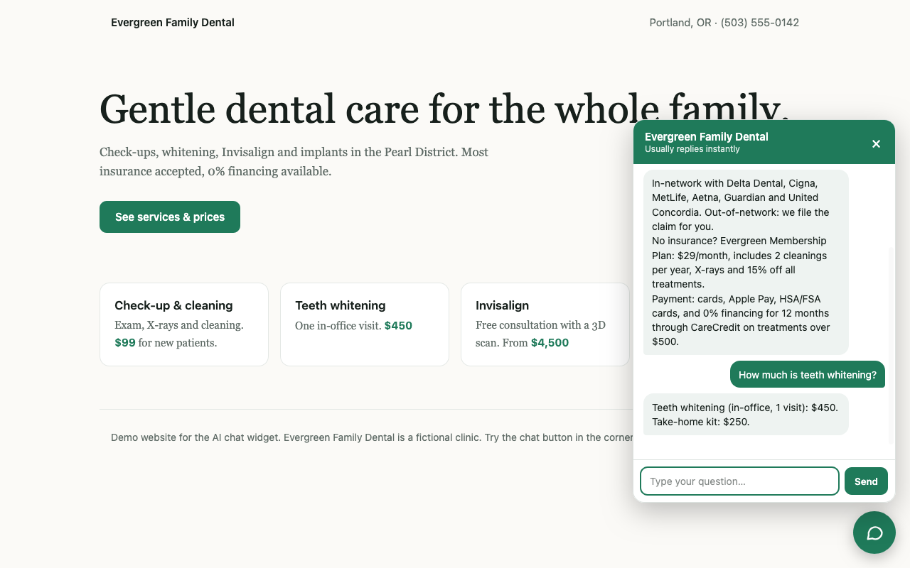

# Automation & AI Bots Portfolio

Small, production-minded tools for local businesses and online shops: AI website chat, AI lead handling, booking bots, web scraping and daily reports. Alerts arrive where the team already works: email, Slack, or Telegram/WhatsApp-style messengers.

| Project | What it does | Stack |
|---|---|---|
| [AI Website Chat](ai-chat-widget/) | A chat bubble for any website (one line of code) that answers visitors from the company's own documents, captures leads and sends them by email and Slack, with an owner dashboard. | Python, Claude API (tool use), JavaScript, Slack, SMTP |
| [Shopify Sales Dashboard](sales-dashboard/) · [**live demo**](https://johnsowhat.github.io/freelance-portfolio/sales-dashboard/?sample) | Drop a Shopify orders export and see revenue, AOV, repeat customers and best sellers vs the previous period. Runs entirely in the browser: the data never leaves the computer. | JavaScript, SVG charts, data analysis |
| [AI Booking Bot](booking-bot/) | Clients book appointments in Telegram, get reminders, and ask questions answered by AI 24/7. The owner gets notifications and manages the schedule from Telegram. | Python, Telegram Bot API, Claude API, SQLite |
| [AI Lead Handler](lead-ai/) | Website form where AI scores every lead hot/warm/cold, summarises it and drafts a personal reply, then sends it to the owner by email (hit Reply to answer the client), Slack or Telegram. No lead is ever lost. | Python, Claude API, SMTP, Slack, Telegram |
| [Competitor Price Monitor](price-monitor/) | Scrapes a shop's whole catalogue every day, compares it with yesterday and sends a report by email, Slack or Telegram with price drops, rises, stock changes and an Excel-ready CSV. | Python, web scraping, SMTP, Slack, Telegram |

Every project comes with self-tests (`python3 <file> test`) and need no paid services to try out.

**Need something like this for your business?** Each project is customised per client: your services, your competitor sites, your language, your schedule.
