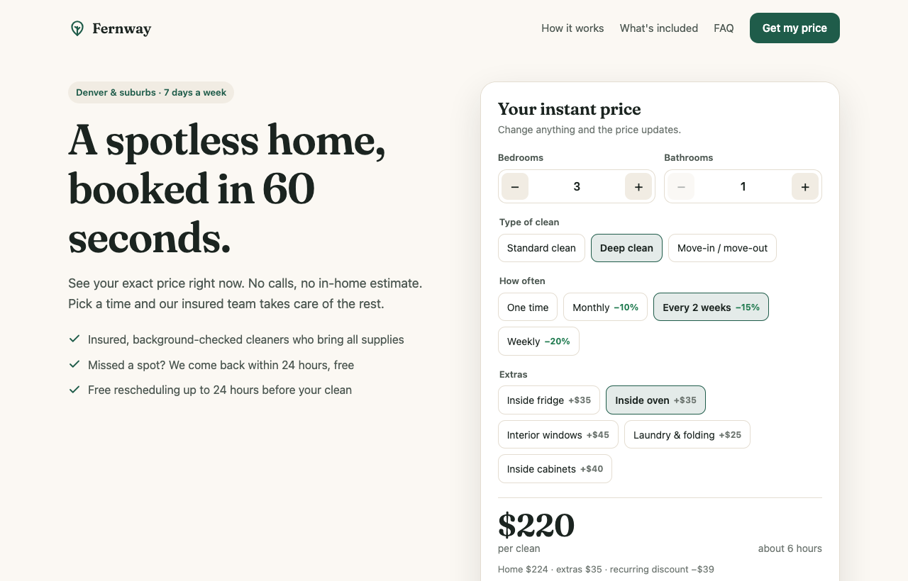
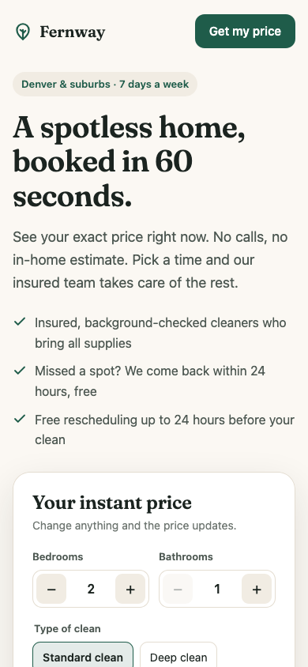

# Cleaning Company Website with an Instant Quote Calculator

**▶ Live demo:** https://johnsowhat.github.io/freelance-portfolio/cleaning-site/

A fast, mobile-first landing page for a home cleaning business (*Fernway Home Cleaning*, a fictional company in Denver) built around one goal: **turn visitors into bookings**. Instead of "call us for a quote", visitors see their exact price in seconds and book right away.

<p>
  
  
</p>

## What's on the page
- **Instant price calculator**: bedrooms, bathrooms, type of clean (standard / deep / move-out), frequency with recurring discounts, extras. The price, the breakdown and the estimated crew time update as you click.
- **Booking form** that opens pre-filled with the chosen quote: name, phone, email, ZIP, date and arrival window, with friendly validation messages
- How it works, what's included in each type of clean (prices pulled from the same calculator, so they never go out of sync), FAQ
- SEO basics: page title and description, Open Graph tags for link previews, LocalBusiness structured data for Google

## Quality
- No framework: loads fast and scores well on Core Web Vitals
- Responsive from phone to desktop, light and dark mode
- Accessible: keyboard friendly, labelled controls, screen-reader announcements for the price
- All prices live in one small file (`pricing.js`) with tests, so the owner's price changes are a one-line edit

## Customising for a client
The same calculator pattern fits any business that quotes by inputs: cleaning, lawn care, painting, moving, pressure washing, solar. In a live setup the booking request goes to the owner's email, a CRM (HubSpot, Jobber, Housecall Pro), Google Calendar or a form service; the demo shows the confirmation without sending anything.

## Run locally
```bash
python3 -m http.server 8091   # then open http://127.0.0.1:8091
node test.mjs                 # pricing tests
```

Tech: HTML, CSS, vanilla JavaScript (ES modules), schema.org JSON-LD, Node test runner.
