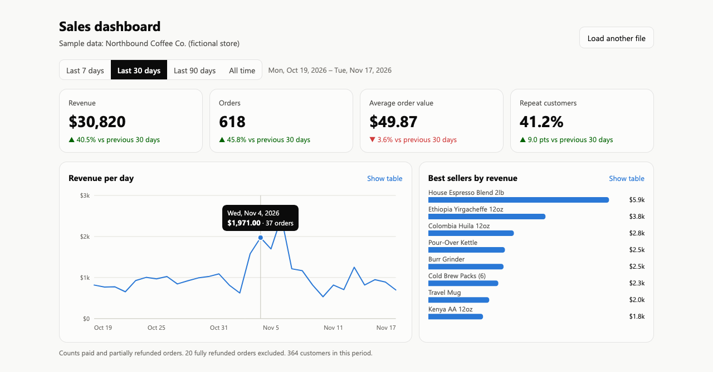
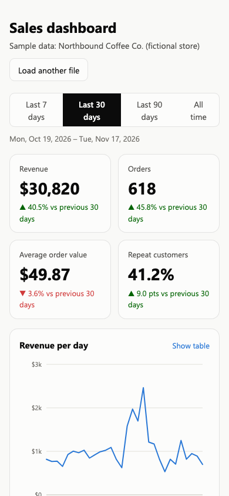

# Shopify Sales Dashboard (runs in the browser)

**▶ Live demo:** https://johnsowhat.github.io/freelance-portfolio/sales-dashboard/?sample

Drop a Shopify orders export and instantly see how the store is doing. No sign-up, no app install, and **the file never leaves your computer**: every number is calculated in the browser.

<p>
  
  
</p>

## What it shows
- **Revenue, orders, average order value, repeat-customer rate**, each compared with the previous period (▲/▼)
- **Revenue per day** with a hover tooltip (date, revenue, orders), so sale spikes and slow days stand out
- **Best sellers by revenue** with units sold
- Date ranges: last 7 / 30 / 90 days or all time
- Every chart has a **table view** with exact values
- Counts only real revenue: paid and partially refunded orders; refunds and pending payments are excluded and reported separately

## Details that matter
- Understands Shopify's export format, where an order with several products spans several rows
- Clear message when someone drops the wrong file ("Missing columns: …")
- Works on phones and in dark mode; keyboard and screen-reader friendly
- No server, no database, no dependencies: one HTML page plus a small JS module. Host it anywhere (GitHub Pages, Netlify, the store's own domain)

## Customising for a client
Typical add-ons: pull orders live from the Shopify API instead of a CSV, revenue by product category or region, cohort retention, a scheduled weekly email with the same numbers.

## Run locally
```bash
python3 -m http.server 8090     # then open http://127.0.0.1:8090/?sample
node test.mjs                   # tests for the CSV parser and the metrics
python3 generate_sample.py      # regenerate the sample data
```

The sample file `sample-orders.csv` is generated data for a fictional store, *Northbound Coffee Co.*

Tech: vanilla JavaScript (ES modules), hand-built SVG charts, CSS custom properties for light/dark themes, Node test runner.
